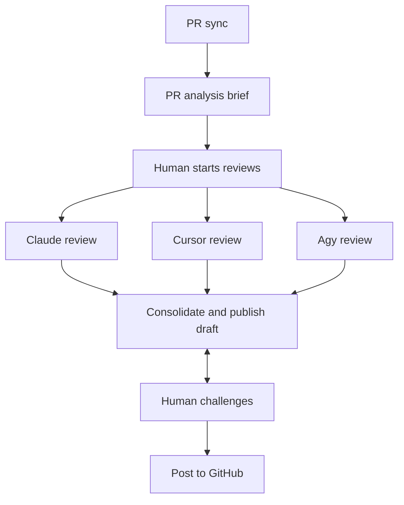
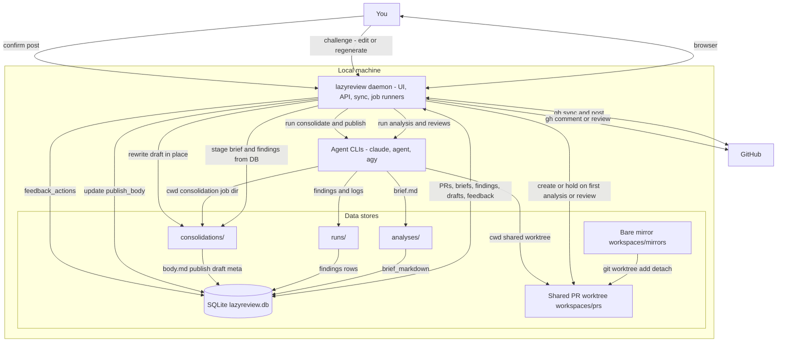
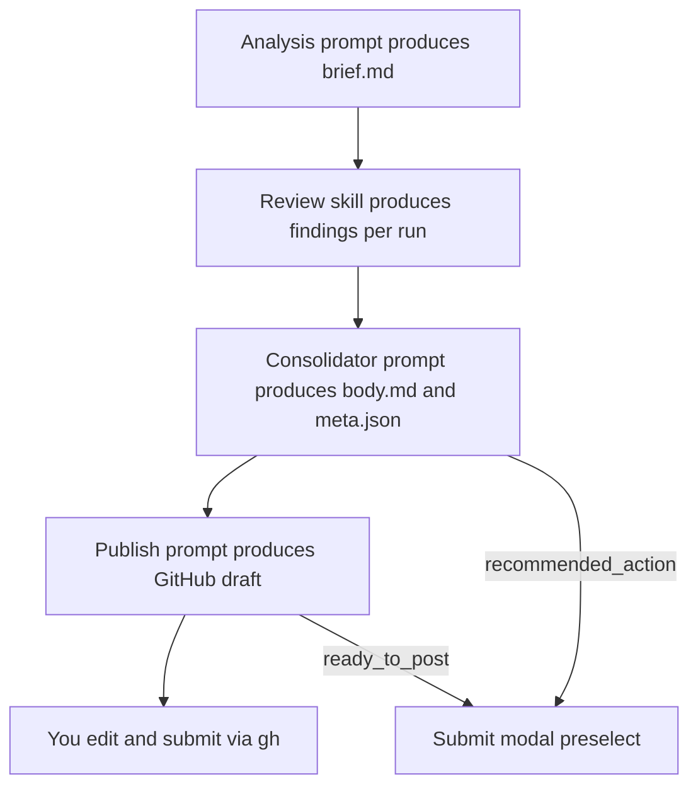

# lazyreview

A local, human-in-the-loop desk for agentic pull-request review.

It finds PRs waiting on you, orients with an analysis brief, lets you run one or
more review agents (Cursor / Claude / Agy), consolidates them into one consensus
with a GitHub-facing draft — and stops. Nothing posts until you say so.

History, costs, and feedback live in SQLite. Worktrees and run logs stay on your
machine. When the PR head moves, stale runs are flagged so you don’t ship a
review for the wrong commit.

## Workflow

After the analysis brief, you kick off one or more agentic reviews. Those runs
feed a single consolidate-and-publish step; you iterate on that draft until it
is ready, then post to GitHub yourself.



## Local architecture

Everything durable stays on your machine. Sync and post talk to GitHub through
`gh`; analysis and every review share one detached worktree per PR (backed by a
bare mirror). Findings and the analysis brief are written into SQLite. Consolidate /
publish / human challenge reuse that stored context in a consolidation job
directory — they do not need a second checkout.



- **One worktree per PR** — created lazily, held while analysis or review jobs run, reused across agents for the same head.
- **SQLite is the handoff** — consolidate does not re-read the worktree; it loads the brief and findings from the DB into `consolidations/{id}/`.
- **Human challenges stay local** — edit or regenerate the draft against that consolidation dir + DB until you post.

## Prompt chaining

Each stage has its own prompt. Analysis, consolidator, and publish prompts are
editable under **Settings**; review runs use the review skill. Outputs of earlier
stages become inputs to later ones — not a single mega-prompt.



1. **Analysis** — orientation brief for the current head (intent, coverage, blast radius).
2. **Reviews** — independent agentic passes; findings stored per run.
3. **Consolidate** — dedupe across runs and existing PR comments; emit an internal report plus `meta.json`.
4. **Publish** — rewrite that report into concise GitHub-facing markdown (still local).
5. **Submit** — you choose the action (`approve` / `request_changes` / `comment`), edit the draft, and post via `gh`. Never auto-posted.

## Prerequisites

- Python 3.12+
- `gh` authenticated (`gh auth login`)
- At least one agent CLI: `agent` (Cursor), `claude`, or `agy`
- Ubuntu with systemd user services (for install/autostart)
- Node/npm (for Tailwind CSS build during install)

## PR analysis & shared workspaces

lazyreview runs a **PR Analysis** job (orientation brief) before reviews or
consolidations can start. At most **`max_concurrent_analyses`** (default `2`)
analyses run at once; the rest stay queued.

Checkouts live under `{data_dir}/workspaces/` (bare mirrors + per-PR worktrees)
and are reused by analysis and reviews. When a PR is closed or merged, its
worktree is queued for deletion.

## Configuration

All daemon settings live in a TOML file:

```
~/.config/lazyreview/config.toml
```

Override the path with `LAZYREVIEW_CONFIG=/path/to/config.toml`.

```toml
[server]
host = "127.0.0.1"
port = 3334

[paths]
data_dir = ""   # empty → ~/.local/share/lazyreview
runs_dir = ""   # empty → {data_dir}/runs

[worker]
job_timeout_seconds = 3600
retention_sweep_seconds = 3600
max_concurrent_jobs = 10  # global parallel reviews (not per-PR)

[service]
unit_name = "lazyreview.service"
```

```bash
lazyreview config          # show effective settings
lazyreview config --init   # write default config if missing
```

Optional env overrides (for one-offs): `LAZYREVIEW_HOST`, `LAZYREVIEW_PORT`, `LAZYREVIEW_DATA_DIR`.

After changing `host`/`port`, re-run `./scripts/install.sh` (or edit the systemd unit bind) then `lazyreview restart`.

## Quick start (dev)

```bash
python3 -m venv .venv
source .venv/bin/activate
pip install -e .
npm install && npm run build:css
lazyreview config --init
lazyreview serve
```

Open http://127.0.0.1:3334 (or whatever `[server]` says). The in-app
[Why lazyreview?](http://127.0.0.1:3334/why) page mirrors this overview.

## Install (Ubuntu, autostart)

```bash
./scripts/install.sh
lazyreview status
```

Uninstall:

```bash
./scripts/uninstall.sh          # keeps DB/runs + config
./scripts/uninstall.sh --purge  # deletes data + config
```

Service control:

```bash
lazyreview start|stop|restart|status|enable|disable
```

## Data layout

- Config: `~/.config/lazyreview/config.toml`
- DB: `{data_dir}/lazyreview.db` (default under `~/.local/share/lazyreview/`)
- Runs: `{data_dir}/runs/{id}/` (prompt, logs, findings, report)
- Clone `repo/` is removed when each run finishes

## Settings (UI)

`/settings` — default agents/models/effort, editable analysis / consolidator /
publish prompts, and run retention (default 1 week). Hourly daemon sweep +
**Purge old runs now**.
