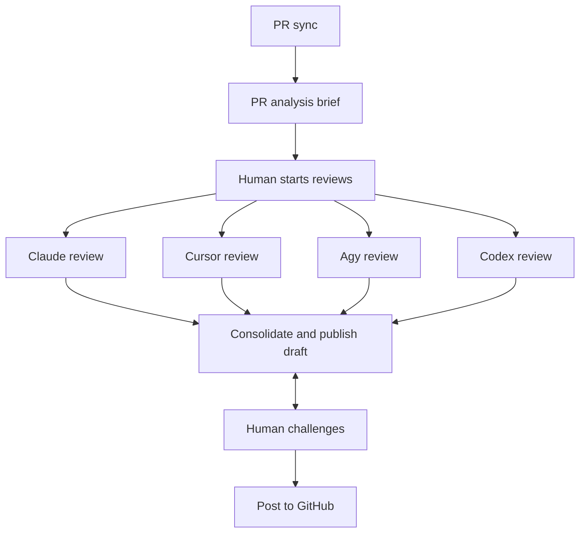
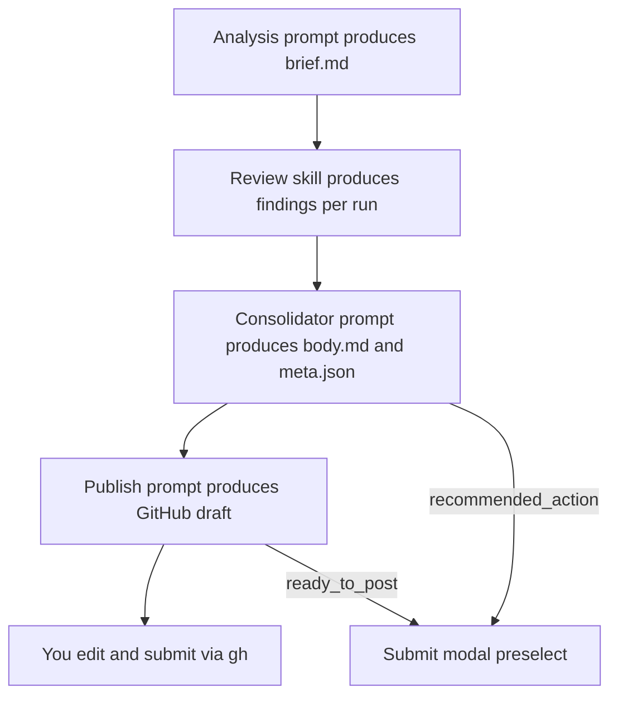

# lazyreview

A local, human-in-the-loop desk for agentic pull-request review.

It finds PRs waiting on you, orients with an analysis brief, lets you run one or
more review agents (Cursor / Claude / Agy / Codex), consolidates them into one consensus
with a GitHub-facing draft — and stops. Nothing posts until you say so.

History, costs, and feedback live in SQLite. Worktrees and run logs stay on your
machine. When the PR head moves, stale runs are flagged so you don’t ship a
review for the wrong commit.

## Workflow

After the analysis brief, you kick off one or more agentic reviews. Those runs
feed a single consolidate-and-publish step; you iterate on that draft until it
is ready, then post to GitHub yourself.



## Local architecture

Everything durable stays on your machine. Sync and post talk to GitHub through
`gh`; analysis and every review share one detached worktree per PR (backed by a
bare mirror). Findings and the analysis brief are written into SQLite. Consolidate /
publish / human challenge reuse that stored context in a consolidation job
directory — they do not need a second checkout.


- **One worktree per PR** — created lazily, held while analysis, review, or interactive chat sessions run, reused across agents for the same head.
- **SQLite is the handoff** — consolidate does not re-read the worktree; it loads the brief and findings from the DB into `consolidations/{id}/`.
- **Interactive chat** — right-rail Explore (PR Q&A) and Challenge (adversarial rounds over consolidation findings). Turns + working findings live in SQLite; Done writes findings/action and re-runs the publish transform. Never auto-posts.
- **Human challenges stay local** — edit, chat, or regenerate the draft until you post.

## Prompt chaining

Each stage has its own prompt. Analysis, consolidator, and publish prompts are
editable under **Settings**; review runs use the review skill. Outputs of earlier
stages become inputs to later ones — not a single mega-prompt.



1. **Analysis** — orientation brief for the current head (intent, coverage, blast radius).
2. **Reviews** — independent agentic passes; findings stored per run.
3. **Consolidate** — dedupe across runs and existing PR comments; emit an internal report plus `meta.json`.
4. **Chat (optional)** — Explore the PR worktree, or Challenge findings / recommended action in rounds; Done syncs findings and regenerates the publish draft.
5. **Publish** — rewrite that report into concise GitHub-facing markdown (still local).
6. **Submit** — you choose the action (`approve` / `request_changes` / `comment`), edit the draft, and post via `gh`. Never auto-posted.

## Prerequisites

- Docker with Compose v2
- A GitHub token (`gh auth token` prints yours)
- Credentials for at least one agent: Claude, Cursor, Agy, or Codex (see below)

The image ships `git`, `gh`, `claude`, `agent` (Cursor), `agy`, and `codex`; nothing
else needs to be installed on the host.

## Run with Docker

```bash
cp .env.example .env        # fill in GH_TOKEN and agent credentials
docker compose up -d --build
```

Open http://127.0.0.1:3334. The in-app
[Why lazyreview?](http://127.0.0.1:3334/why) page mirrors this overview.

```bash
docker compose down          # stop (data is kept in volumes)
docker compose up -d         # start again
docker compose restart       # after editing config.toml
docker compose logs -f       # follow daemon logs
```

The UI has no auth and can post to GitHub, so it is published on
`127.0.0.1` only. Set `LAZYREVIEW_HOST_PORT` in `.env` to use another host
port, or `LAZYREVIEW_BIND=0.0.0.0` to expose it on your network. The server
also rejects requests whose `Host` header isn't `localhost` or `127.0.0.1`
(this blocks DNS-rebinding pages), so when you expose it, list the names you'll
use in `LAZYREVIEW_ALLOWED_HOSTS` (comma-separated).

The Claude, Cursor, and Codex CLI versions are pinned as build args in the
`Dockerfile`, because lazyreview parses their output. To upgrade one, bump it
and run the tests, e.g.
`docker compose build --build-arg CODEX_VERSION=0.163.0`. The `agy` installer
only serves its latest release, so `docker compose build --pull` picks up a new one.

### Credentials

Set them in **Settings → Credentials**, or in `.env` (gitignored). A key saved
in Settings overrides the `.env` value and takes effect for the next run
without a restart; it is stored in `/data/credentials.json` (mode 600) and
never sent back to the browser. The same page checks whether each CLI is
authenticated and offers a browser login for GitHub, Cursor, Agy, and Codex
(GitHub and Codex show a device code; Agy asks you to paste back the code
Google shows). Claude has no browser login there:
run `claude setup-token` anywhere and paste the token.

The `.env` variables:

| Variable | Used by |
| --- | --- |
| `GH_TOKEN` | `gh` and HTTPS `git` (sync, clones, posting) |
| `CLAUDE_CODE_OAUTH_TOKEN` (from `claude setup-token`) or `ANTHROPIC_API_KEY` | `claude` |
| `CURSOR_API_KEY` | `agent` |
| `GEMINI_API_KEY` | `agy` (lazyreview sets `modelProvider: "gemini"` for it while the key is set) |
| `CODEX_API_KEY` | `codex` (OpenAI API billing; the browser login uses a ChatGPT plan instead) |

Browser logins are stored by each CLI under `/home/app` and persist in the
`lazyreview-home` volume. A key, when set, takes priority over a browser login
for that CLI. Each agent run gets `GH_TOKEN` plus only its own provider's keys.

Codex's own sandbox can't start inside Docker, so Codex chat runs with its
shell tools turned off: it answers from the analysis brief, findings, and
conversation, but can't open files the way Claude chat can. Codex reviews,
analyses, and consolidations run unrestricted inside the container, like the
other agents.

### Review skill

Review runs copy the `pr-code-review-batch` skill into each worktree. It ships
in `src/lazyreview/skills/`, so edit it there and rebuild the image. Outside
Docker, a skill of the same name under `~/.cursor/skills`, `~/.agents/skills`,
or `~/.claude/skills` takes precedence over the bundled copy.

### Volumes

- `lazyreview-data` → `/data`: `config.toml`, `lazyreview.db`, runs,
  sessions, analyses, consolidations, workspaces. Paths stored in the DB point
  under `/data`, so keep this mount path.
- `lazyreview-home` → `/home/app`: agent CLI state and any interactive logins.

`docker compose down -v` deletes both.

Coming from the old systemd install? Start with fresh volumes: the old
`~/.local/share/lazyreview/lazyreview.db` stores absolute host paths for logs
and worktrees, so copying it into `/data` leaves those links broken. Past runs
stay readable on the host.

## PR analysis & shared workspaces

lazyreview runs a **PR Analysis** job (orientation brief) when a PR is first
added to the system (and whenever you click **Run analysis** / **Retry**). New
commits on an existing PR do **not** auto-retrigger analysis. At most
**`max_concurrent_analyses`** (default `2`) analyses run at once; the rest stay
queued.

Checkouts live under `{data_dir}/workspaces/` (bare mirrors + per-PR worktrees)
and are reused by analysis and reviews. When a PR is closed or merged, its
worktree is queued for deletion.

## Configuration

All daemon settings live in a TOML file: `/data/config.toml` in the container
(created on first start), `~/.config/lazyreview/config.toml` when running
outside Docker. Override the path with `LAZYREVIEW_CONFIG=/path/to/config.toml`.

```toml
[server]
host = "127.0.0.1"
port = 3334

[paths]
data_dir = ""   # empty → ~/.local/share/lazyreview
runs_dir = ""   # empty → {data_dir}/runs

[worker]
job_timeout_seconds = 3600
retention_sweep_seconds = 3600
max_concurrent_jobs = 10  # global parallel reviews (not per-PR)
max_concurrent_analyses = 2
```

Under Docker, `host`, `port`, and `data_dir` are fixed by the image
(`LAZYREVIEW_HOST`, `LAZYREVIEW_PORT`, `LAZYREVIEW_DATA_DIR` env overrides);
only the `[worker]` settings are worth editing there:

```bash
docker compose exec lazyreview lazyreview config   # show effective settings
docker compose cp lazyreview:/data/config.toml ./config.toml
# edit ./config.toml, then:
docker compose cp ./config.toml lazyreview:/data/config.toml
docker compose restart
```

## Quick start (dev, without Docker)

Needs Python 3.12+, Node/npm, `gh`, and an agent CLI on your `PATH`.

```bash
python3 -m venv .venv
source .venv/bin/activate
pip install -e '.[dev]'
npm install && npm run build:css
lazyreview config --init
lazyreview serve
```

## Data layout

- Config: `/data/config.toml` under Docker, else `~/.config/lazyreview/config.toml`
- DB: `{data_dir}/lazyreview.db` (`/data` under Docker, else `~/.local/share/lazyreview/`)
- Runs: `{data_dir}/runs/{id}/` (prompt, logs, findings, report)
- Chat sessions: `{data_dir}/sessions/{id}/` (round prompts, logs)
- Clone `repo/` is removed when each run finishes

## Settings (UI)

`/settings` — default agents/models/effort (including interactive chat defaults),
editable analysis / consolidator / publish prompts, and retention for finished runs
**and** chat sessions (default 1 week). Hourly daemon sweep + **Purge old runs now**.
