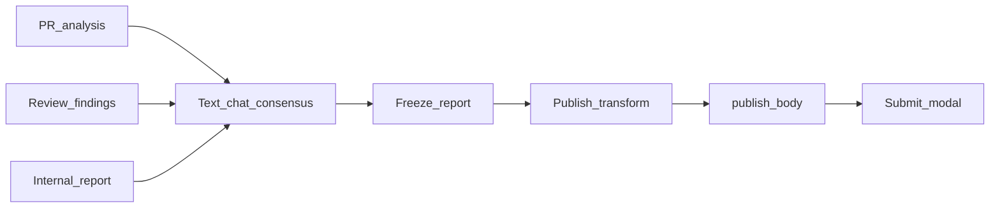

# Future: voice I/O on interactive sessions

**Status:** The **text + worktree** path is implemented as Interactive PR sessions
(Explore / Challenge chat in the webapp — see plan “Interactive PR sessions”).
This file keeps the **voice** extension only.

Voice remains an input/output skin on the same text turns:

```text
mic → SpeechToText.transcribe → POST .../messages (text)
assistant turn text → TextToSpeech.synthesize → play in browser
```

Do not add a separate voice agent path. Turns stay plain text in SQLite.

## Suggested sequence

1. **Text chat consensus** over analysis brief, review findings, and the internal
   consolidation report (`body.md` + `meta.json`).
2. **Mutate / freeze** the consensus report (and optionally findings) when the human
   is done editing via chat.
3. **Re-run publish transform** against the frozen report → new `publish_body`.
4. Human confirms in the existing submit modal (never auto-post).



## Conversation / findings mutation model

- Store chat turns separately from consolidations (new tables), keyed by PR + head SHA
  (and optionally consolidation id).
- Chat may propose edits to kept findings, stance, or `recommended_action`; apply only
  when the human accepts a turn’s patch.
- While chat is open, treat the consolidation report as draft: clear `ready_to_post`
  and `publish_body` if the frozen report changes.
- On freeze: write updated `body.md` / `meta.json` (or DB equivalents), then enqueue the
  same publish transform used today.
- Regenerating consolidation starts a new report and invalidates prior chat freeze for
  that consolidation.

## STT / TTS adapters

Keep speech out of the chat core. Behind narrow interfaces:

```text
SpeechToText.transcribe(audio) -> text
TextToSpeech.synthesize(text) -> audio
```

Swap providers (ElevenLabs, Gemini, Whisper, browser Web Speech, etc.) without changing
turn storage, consensus patches, or the publish pipeline. Voice is an input/output skin
on the same text chat.

## Non-goals (this future phase still)

- Auto-posting to GitHub
- Shipping voice in the consolidation/publish Phase 1 ship
- Replacing the Settings-editable publish prompt
- Changing review-run prompts to consume analysis (separate optional later)
